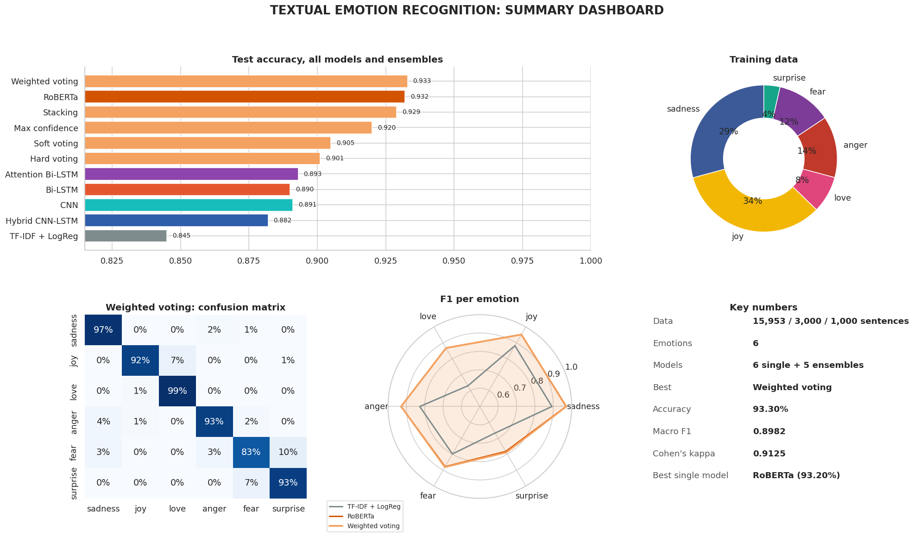
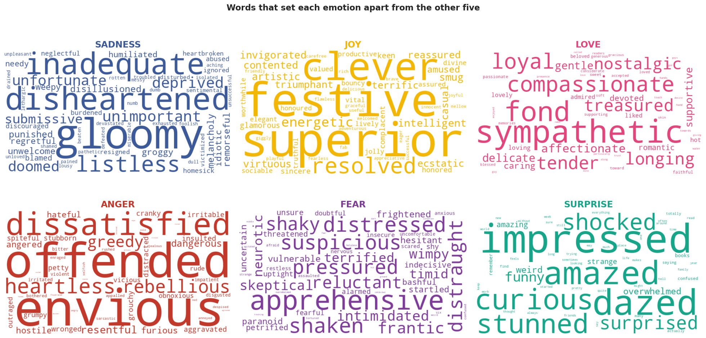
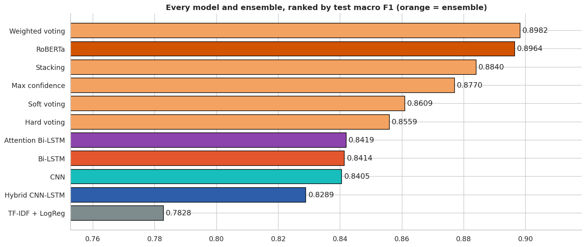
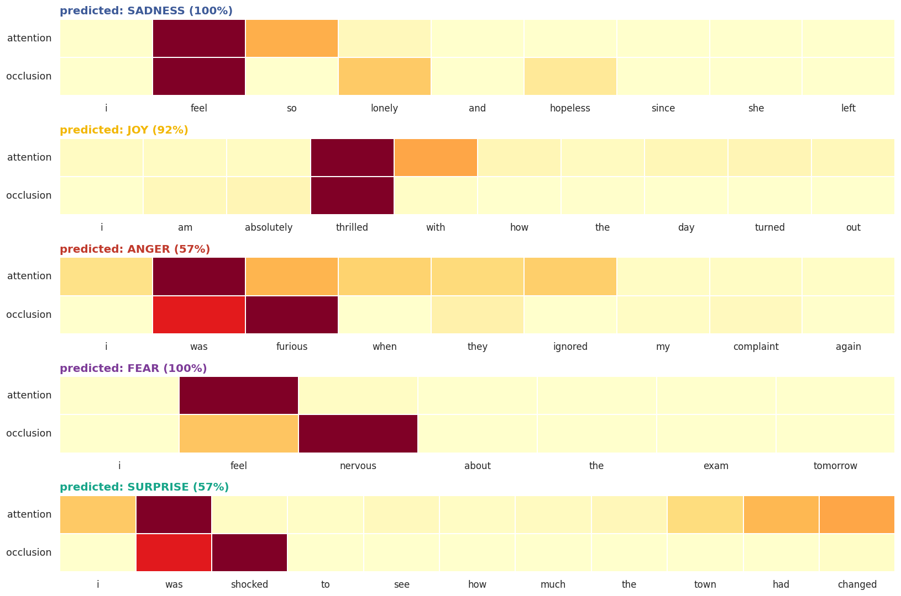
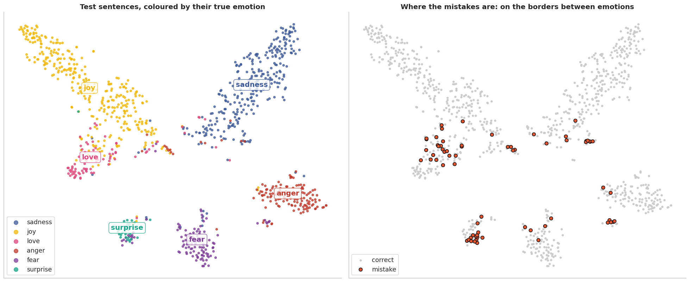
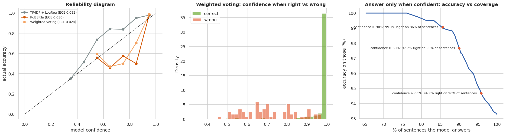
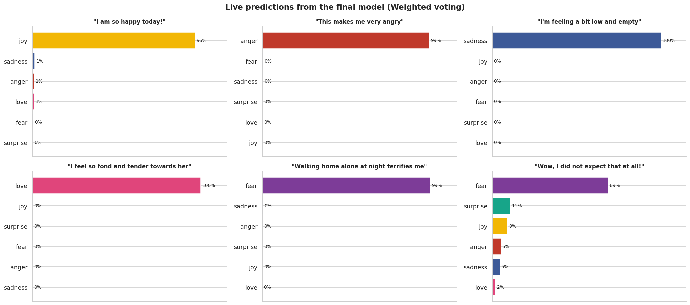

# Textual Emotion Recognition

[](https://colab.research.google.com/github/FaiazPronoy/Textual-Emotion-Recognition/blob/main/textual_emotion_recognition.ipynb)


**Teaching a machine to name the emotion in a sentence, from a simple baseline to a fine-tuned Transformer.**

| | |
|---|---|
| **Program** | CVIS Hands-on Training Project, BRAC University |
| **Semester** | Summer 2025, rebuilt in October 2026 |
| **Type** | Individual project |
| **Made by** | Faiaz Abrar Zaman Pronoy |
| **Supervisor** | Dr. Md. Ashraful Alam, CVIS Research Lab |
| **Versions** | [v1.0, the training submission, and v2.0, the rebuild](../../releases) |

---

## Results

Scores on 1,000 test sentences. No model, weight or setting was chosen on them.

| Model | Accuracy | Macro F1 |
|---|---|---|
| TF-IDF + Logistic Regression | 84.5% | 0.783 |
| Hybrid CNN-LSTM | 88.2% | 0.829 |
| Bi-LSTM | 89.0% | 0.841 |
| 1D CNN | 89.1% | 0.841 |
| Attention Bi-LSTM | 89.3% | 0.842 |
| RoBERTa (fine-tuned) | 93.2% | 0.896 |
| **Weighted vote of all six (final)** | **93.3%** | **0.898** |



| | |
|---|---|
|  |  |
|  |  |

---

## The task

Each sentence is an English tweet with one of six labels: sadness, joy, love, anger, fear or surprise.
The classes are imbalanced. Joy is 34% of the data and surprise only 4%.

| Split | Sentences |
|---|---|
| Training | 15,953 |
| Validation | 3,000 |
| Test | 1,000 |

## How it works

1. **Clean.** Remove 47 training sentences that were duplicates or also appeared in validation or test.
2. **Preprocess.** Lowercase, strip symbols and stem words. Stop words like "not" stay, since they flip meaning.
3. **Balance.** Softened class weights give rare emotions more attention without over-predicting them.
4. **Train six models.**
   - A TF-IDF and logistic regression baseline.
   - Four deep models trained from scratch: Bi-LSTM, a 1D CNN with three filter widths, a hybrid CNN-LSTM, and a Bi-LSTM with attention.
   - RoBERTa, a Transformer pre-trained on 160 GB of English and fine-tuned on these emotions.
5. **Combine** them five ways: hard voting, soft voting, weighted voting, max confidence and stacking. All weights are learned on validation data.
6. **Evaluate** with accuracy, macro F1, Cohen's kappa, ROC and precision-recall curves, and calibration.
7. **Explain** with attention weights, word occlusion, a t-SNE map and the learned word embeddings.

## Findings

- Pre-training is the big step. Models trained from scratch reach about 89%. RoBERTa reaches 93%.
- The ensemble trusts RoBERTa most and adds a small gain on top.
- Love and surprise are the hardest emotions. Love is often confused with joy.
- Confidence is meaningful. When the model is at least 90% sure, it answers 86% of sentences and gets 99.1% of those right.
- Removing one word at a time shows that emotional words like *lonely*, *thrilled* and *furious* decide the prediction.



Try any sentence with `predict_emotion()`:



---

## Built with

| Part | Tools |
|---|---|
| Deep learning | TensorFlow and Keras |
| Transformer | PyTorch and Hugging Face Transformers |
| Classic ML and metrics | scikit-learn |
| Text | NLTK (Porter stemmer), WordCloud |
| Charts | Matplotlib, seaborn |

## Run it

The notebook needs a GPU for RoBERTa.

- **Kaggle:** import the notebook, add the [Emotion Dataset](https://www.kaggle.com/datasets/parulpandey/emotion-dataset), choose a GPU and turn Internet on. A full run takes about 10 minutes.
- **Colab:** click the badge and pick a GPU runtime. The data downloads from this repository.
- **On your computer:**

```bash
pip install -r requirements.txt
jupyter notebook textual_emotion_recognition.ipynb
```

## Project structure

```
textual_emotion_recognition.ipynb   the notebook
data/                               training, validation and test sets
docs/images/                        charts used in this README
report/                             the training report (v1)
requirements.txt                    Python packages
```

---

## Versions

| | v1.0 (2025) | v2.0 (2026) |
|---|---|---|
| Models | Bi-LSTM, CNN, hybrid CNN-LSTM | A baseline, four deep models and RoBERTa |
| Best accuracy | 89.8% | 93.3% |
| Ensembles | Weights and stacking learned on test or training data | Everything learned on validation data |
| Data checks | None | Duplicates and test overlap removed |
| Rare emotions | No handling | Softened class weights and macro F1 |
| Explainability | Word clouds, confusion matrices and confidence plots | Attention, word occlusion, t-SNE, calibration |

v2 removes the leaks of v1, so its scores are honest estimates for new sentences.

## Data

The [Emotion Dataset](https://www.kaggle.com/datasets/parulpandey/emotion-dataset) on Kaggle, 20,000 labelled English tweets.

## Author

- **Faiaz Abrar Zaman Pronoy** (ফাইয়াজ আবরার জামান প্রনয়)

## Licence

Copyright 2025-2026 Faiaz Abrar Zaman Pronoy. All rights reserved.
You may read the code and run it to try it out. You may not copy it, hand it in
as your own work, or publish it. See [LICENSE](LICENSE).
